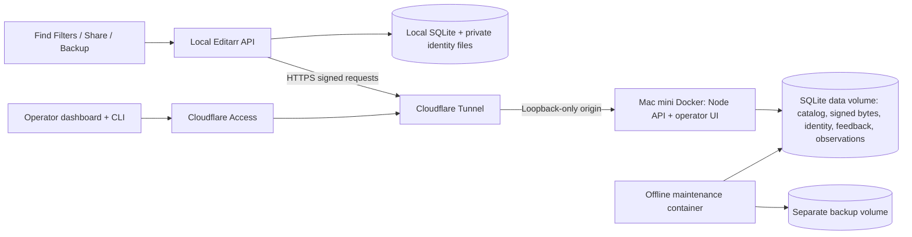

# Editarr community scan service plan

Status: **Long-term plan and coding tasks drafted; confirmed choices recorded below;
remaining format, membership-method, operational and launch decisions explicitly gated**

Prepared: **September 25, 2026**. Provider documentation checked September 25–26, 2026.

The supplied previous ChatGPT conversation was readable and has been incorporated.
This plan combines that discussion, the current request, and inspection of the current
Editarr implementation. Recommendations below remain proposals until accepted.

Supporting documents:

- [Coding tasks, dependencies, acceptance and handoffs](community-scan-service-tasks/README.md)
- [Service contracts, identity, and storage](community-scan-service-contracts.md)
- [Database upgrades, backups, and implementation sequence](community-scan-service-implementation.md)
- [Discord enrollment and signing keys](community-scan-service-discord-enrollment.md)

## 1. Intended outcome

An Editarr installation can donate scan evidence or manual filters to a central service.
Another installation uses **Find Filters** to discover compatible contributions, compare
their provenance and community feedback, and download selected contributions into its
local scan/review workflow. Scanning and playback decisions remain local.

The service should require little infrastructure and no conventional end-user account
creation, password resets, or email administration. Discord sign-in and membership in
the Editarr Discord server gate community access. Contributors still need persistent
service identities, credentials, revocation and moderation.

Database upgrades must preserve data. Backups must protect both local work and the
credentials that carry an installation's community identity and reputation.

## 2. Decisions and questions

### Confirmed requirements

- Central repository indexed by media identity and file/release information.
- Find Filters downloads reusable contributions and exposes descriptive metadata.
- Persistent contributor attribution and reputation, with download counts.
- Support comparing scanner/settings/model provenance and audio/video finding counts.
- Introduce database versioning and replace the current development-wipe guidance.
- Plan database/settings backup and restore, including community credentials.
- **Self-host the community service in Docker on a Mac mini** — selected October 5,
   superseding Workers/D1 deployment; preserve limits and do not add paid services.
- Major product/architecture choices require the user's input.

### Product choices confirmed during planning

The user selected the following choices. Remaining recommendations and implementation
parameters are identified separately; this plan does not authorize implementation.

| ID | Decision | Selected approach | Status |
| --- | --- | --- | --- |
| D01 | Provider and spending | Docker on a Mac mini with Node + SQLite; exact signed bytes remain in the database; no paid service or public activation inferred | Updated October 5; see [Docker runtime](community-service-docker.md); launch remains gated |
| D02 | What identity follows | Portable installation signing key stored durably and included in backups; rotation preserves contributor identity | Confirmed; signing keys reaffirmed under D20; encryption optional under D06 |
| D03 | First release scope | Write the complete long-term plan, then decide launch scope | Confirmed; no launch boundary chosen |
| D04 | Enrollment and publishing | Discord sign-in and Editarr Discord membership required; limited uploads from new contributors | Updated September 26; replaces unrestricted automatic enrollment |
| D05 | Uncertain media matches | Show separately; require explicit selection and review | Confirmed |
| D06 | Backup scope and encryption | Full database bundle plus settings/identity-only export; encryption optional and off by default for both, including backups containing credentials and signing keys | Updated September 27, 2026; supersedes mandatory encryption |
| D07 | Donation behavior | Manual sharing first; separately opt in to automatic sharing | Confirmed |
| D08 | Public name | Three-word generated or custom display name; current NFC/lowercase/NFC uniqueness, unrestricted valid name changes, current profile revision returned to clients | Confirmed; refined October 1 |
| D09 | Contribution types | AI scans and manual/edited filter sets, preserving source attribution and marking derivatives | Confirmed |

### Architecture and launch policy decisions

Confirmed architecture choices are recorded here alongside the explicitly deferred sharing policy.

| ID | Question | Answer or proposal | Status / needed by |
| --- | --- | --- | --- |
| D10 | Should lookup/download require installation registration? | Require an authorized installation credential for reads and writes, following Discord enrollment | Authentication confirmed; enrollment updated under D19 |
| D11 | Community service packaging | TypeScript service in `community-service/`, deployed separately as a Docker image with the operator UI; Worker remains a regression harness | Updated October 5 |
| D12 | How should feedback affect sorting and upload rights? | Compatibility first, then revision-only Wilson vote quality. Downloads/uploads remain statistics, not trust; author boosts and author reputation tiers deferred | CSS-53 formula/no decay approved October 4; no usage-based admission |
| D13 | What sharing license and withdrawal policy should apply? | Retain public notes under standing community permission to copy/share/modify; per-donation rights-to-share and exact-preview confirmation, preserved attribution/compatible source terms; no license picker or author withdrawal beyond operator moderation | Confirmed October 3, 2026; supersedes deferral, no CC or noncommercial license selected |
| D14 | Which existing unversioned databases must upgrade? | Support the verified current schema; stop safely on unknown older schemas | Confirmed |
| D15 | How much operation is acceptable? | Include a small hosted operator dashboard as well as CLI maintenance/recovery tooling | Confirmed |
| D16 | Are the protocol/version policies acceptable? | Ed25519 without X.509; separate scanner/schema versions; Alembic locally and existing numbered SQL migrations in self-hosted SQLite | Deployment updated October 5; protocol and signing keys unchanged |
| D17 | How should the operator dashboard authenticate? | Cloudflare Access for operators, protecting both UI and admin API; contributor enrollment stays independent | Confirmed |
| D18 | When should contributor keys rotate and retire? | Rotation only when the user manually triggers it in Editarr's UI; retire the old key immediately when the replacement is activated, with no grace period | Confirmed September 26, 2026 |
| D19 | External sign-in and admission | Discord OAuth2 and membership in the Editarr Discord community; creating that server is a prerequisite to-do | Confirmed; membership alone, with no extra screening/approval-role requirement |
| D20 | Keep signing after introducing Discord? | Retain local Ed25519 keys, signed API requests, and signed contribution artifacts for verifiable uploader attribution; Discord gates enrollment and eligibility | Confirmed September 26, 2026; service-token replacement declined |
| D21 | Multiple installations | Separate signing keys per installation under one Discord contributor; rotate/revoke each independently; reputation and votes remain shared | Confirmed September 26, 2026 |
| D22 | Membership freshness, outage and rejoin | Recheck on use after 15 minutes; pause community reads/writes if an expired check cannot refresh; restore access after successful rejoin verification unless separately suspended; local use remains available | Confirmed; single-member bot REST selected October 1 after CSS-70; live verification remains OPS-01 |
| D23 | Partial and legacy donations | Allow partial scans and older scans with unknown provenance, clearly labeled with coverage and unknown metadata | Confirmed September 26, 2026 |
| D24 | Lost installation key | Fresh Discord authorization plus an explicit recovery action in Editarr's UI may register a replacement and immediately retire the lost key | Confirmed; replacement is scoped to the affected installation |
| D25 | Public event notes | Allow bounded user-written event notes/comments, shown explicitly in the sharing preview | Confirmed September 26, 2026; no complete transcripts/debug output |

Runtime tolerance, rating priors, retention periods, backup schedule,
service hostname, and exact baseline schema fingerprint must be recorded before launch. They
are configurable policy parameters, not numbers to silently infer from this draft.

## 3. Current code and what it implies

| Existing behavior | Relevant code | Planning consequence |
| --- | --- | --- |
| Radarr, Sonarr, and Jellyfin already work | `scanner/integrations/arr.py`, `scanner/integrations/jellyfin.py` | Extend adapters; do not plan these integrations as new products |
| Release name/group, provider ID, duration, and video hash exist on scans | `scanner/persistence/rows/db_scans.py` | Reuse data but add typed, versioned identity and provenance |
| Find Filters searches local completed scans and associates them | `scanner/persistence/repository/repository_catalog.py`, `scanner/http/catalog_source_api.py`, `web/src/scans/use-find-filters.ts`, `web/src/scans/find-filters-dialog.tsx` | CSS-47 local discovery, CSS-48 protected lookup, CSS-49 explicit channel UI, CSS-50 verified multi-download/reuse/reconciliation and CSS-54 private feedback/quality displays are integrated in catalog. Reports remain CSS-56 |
| Matching uses scene/group, filename, format, and a two-second duration check | `repository_catalog.py` | These are heuristics, not timing guarantees; a scene/group match currently bypasses a duration check |
| Large-file cache hashes use MD5 of the first and last 10 MiB | `scanner/pipeline/cache.py` | Keep legacy cache semantics separate from a new public fingerprint contract |
| Scans are reusable evidence; saved reviews own editable snapshots | `scanner/persistence/rows/db_reviews.py`, `repository_review_create.py` | Download once, preserve source evidence, then reuse existing review/export behavior |
| EDL and MCF import/export already exist | `scanner/formats/`, `repository_imports.py` | Add a richer interchange envelope rather than losing provenance through an EDL round trip |
| Startup calls `Base.metadata.create_all()` | `scanner/db.py` | No incremental upgrade chain exists; introduce migrations before new persistent features |
| Version `0.1.0` is repeated in Python and frontend metadata | `pyproject.toml`, `scanner/__init__.py`, `web/package.json` | Establish a single release authority and immutable scan-time provenance |
| State spans SQLite, deployment preferences, and secret files | `scanner/settings/`, `scanner/security/auth_crypto.py`, `scanner/runtime/` | A database-only copy cannot be the complete identity/settings backup |

Sonarr identity needs particular attention: the existing adapter reads `tvdbId` from
the record supplied to it and also exposes season/episode numbers. It does not yet
define whether every ID is a series or episode ID, or persist a complete typed
episode identity. Verify real upstream response fixtures before changing that mapping.
Catalog runtime in the Arr adapter can be rounded minutes; probe the file for timing.

## 4. Self-hosted architecture and deployment verification

The October 5 decision selects one Node 24 LTS Docker service and one local SQLite
database per environment. The browser talks to the local Editarr API; the local
backend retains installation credentials. The community container serves the signed
API, Discord enrollment pages/callback and protected operator assets. It contains no
scanner, AI inference, media processing or media-server credentials. The shared
regression suite uses Node and the production SQLite adapter, without a provider test pool.

SQLite stores searchable summaries and lifecycle state alongside exact immutable gzip
artifact, manifest and signature BLOBs. Publication remains one atomic transaction.
Use WAL, FULL synchronous durability and an exclusive single-writer lock on a local
data volume, not a network or cloud-synchronized filesystem. Startup refuses missing,
unknown or outdated schemas; initialization and verified-backup-first numbered SQL
upgrades are explicit offline commands. The API cannot mount the backup volume;
offline maintenance has no service secrets or listener. No queue or object store is added.

The loopback-only published origin trusts tunnel-supplied client IPs only after
explicit configuration. Preserve the external HTTPS Host. Access protects `/admin`
and `/admin/*`; the application also verifies JWTs, subjects and mutation CSRF.
Contributor signing and Discord eligibility remain independent of Access. Default
configuration and runtime stays disabled. See the [Docker runbook](community-service-docker.md)
for activation, limits, mounts, backups, upgrades and restore boundaries.

The current local app stays useful if the community service is disabled or offline.
Availability queries are separate from artifact downloads. Preserve cached search
results with a visible stale indicator; never present a failed lookup as zero matches.

### Capacity and local usage

Workers CPU/request allowances and D1 database/billing limits are historical design
inputs, not Docker runtime constraints. The [October 3 storage record](community-scan-service-tasks/d1-storage-scope.md)
still explains the single-database/exact-BLOB choice. It does not authorize a D1
deployment, bucket, provider export or database transfer for this runtime.

The October 7 local Docker decision removes usage-based admission: requests,
uploads, downloads, renames and reports have no per-user daily/hourly allowances,
shared/IP buckets, aggregate payload caps or recorded-usage pauses. Keep passive
usage and byte observations with unknown-aware provenance. Historical resource
labels do not imply cloud billing. SQLite logical changes include triggers;
scanned-row counts remain unknown. Durable operations and replay protection remain.
Per-operation validation, bounded query/page/cache work, authority checks and
provider-side cooldowns still apply.

October 7: the user canceled CSS-68 as inapplicable to local Docker on Mac mini.
No capacity benchmark or recovery harness is required under that task. Hardware
headroom and independent recovery remain unverified risks for CSS-69's explicit
launch disposition, not measured results. Payload counters are not total disk
usage. Existing authority/validation bounds and provider constraints remain;
no paid plan, sharding or retention policy is inferred.

### Remaining release checks and owners

The October 6 review found no confirmed regression: 599 shared service tests,
27 Node runtime tests, TypeScript checking, Docker build, Node 24 signed publication,
container crash recovery, second-writer refusal and verified backup passed. This is
local/synthetic evidence, not completion of the release tasks below.

| Required check | Owner and required evidence |
| --- | --- |
| Broader Docker API parity | [CSS-66](community-scan-service-tasks/66-integration-and-abuse.md): enrollment/profile, membership, rotation/recovery, catalog/download, receipts/votes/reports, moderation/dashboard/CLI and cleanup through real Node HTTP/SQLite, including failure/retry cases |
| Live Discord, Access and Tunnel | [Operator setup](community-scan-service-tasks/operator-setup.md): approved hostname/callback, membership checks, Access session/key lifecycle, exact Host and unspoofable ingress boundary; contributor routes must not require operator login |
| Image and Mac recovery | [CSS-67](community-scan-service-tasks/67-packaging-and-user-docs.md): ARM64 and supported AMD64 builds, real mounts/secrets, image replacement, graceful/hard restart, Mac/FileVault/Docker cold boot and rollback runbook |
| Canceled capacity/recovery audit | [CSS-68](community-scan-service-tasks/68-free-tier-load-audit.md): explicitly canceled October 7 for local Docker on Mac mini; [CSS-69](community-scan-service-tasks/69-pilot-and-launch-scope.md) records unverified-risk dispositions, not a substitute audit |
| Existing D1/archive cutover, only if needed | CSS-67 defines and tests the explicitly gated offline import procedure, reusing CSS-66 fixtures. Unknown schemas are never stamped, and no current command directly adopts D1/CSS-60/61 output |
| Pilot and activation | [CSS-69](community-scan-service-tasks/69-pilot-and-launch-scope.md): evidence matrix, explicit deferrals and user-selected launch scope; no public activation from passing local tests |

Community-service backup schedules, off-site destination/protection, retention and cutover remain
explicit operational decisions. Preserve original databases/volumes and obtain a
verified recoverable backup before any approved existing-data migration.

October 6: the user deferred CSS-64 community retention without approving a policy,
and selected CSS-65 local-app scheduled backups: explicit hourly interval,
existing writable destination, count-based oldest-first pruning only after verified
success, and optional encryption using an external protected passphrase file.
Local scheduling defaults disabled; no live schedule or service activation was
authorized. See [CSS-65](community-scan-service-tasks/65-optional-scheduled-backups.md).

October 8: the user reopened CSS-64 and approved retain-first. Keep signed payloads,
lineage, identity/public-key history, durable operations, import uniqueness, votes,
reports and audits indefinitely; preserve existing transient expiry and log
rotation only. No durable-data deletion, service backup schedule or manual-backup
pruning is approved. CSS-65 policy is unchanged. See the
[retention matrix](community-scan-service-tasks/64-retention-cleanup.md#approved-retention-matrix).
CSS-68 remains canceled and CSS-69's local-only pilot remains the selected scope.

## 5. Identity without conventional accounts

Discord now gates enrollment. Bind the verified Discord user ID privately to a stable
contributor ID; repeat sign-ins or replacement installations must not create fresh
reputation or contributor identity. Public generated/custom names remain independent of Discord names.
Each installation has its own key history under that contributor; rotating or revoking
one installation does not affect the others. Restoring a backup copies that installation's
identity/key, rather than silently enrolling a new installation or generating a new key.
See the [Discord design](community-scan-service-discord-enrollment.md) for prerequisites,
membership checks, and the confirmed use of signing keys alongside Discord.

Under confirmed D20, generate a private key
once on the local backend, store it durably, and prove possession during Discord-bound
registration. Subsequent requests and contribution payloads are signed. Discord
establishes account eligibility; signatures bind requests and artifact bytes to the
registered uploader key. The private key never leaves the installation except through
the user's backup/export workflow, with encryption available as an opt-in.

An initial key identifier can be derived deterministically from its public key; keep
the contributor ID independent so rotating keys preserves reputation. Random names
are display labels, never credentials. A shortened stable ID disambiguates duplicates.
No email, password, user recovery inbox, or client certificate authority is required.

Key rotation is an explicit action in Editarr's community identity settings. It never
runs on a schedule or automatically on startup, upgrade, restore, or transfer. Activating
the replacement key and retiring the old key happen atomically on the service, with
no grace period. The contributor ID and reputation stay unchanged. The UI explains
that other copies using the old key lose access and prompts for a fresh
backup after success. Historical signatures remain verifiable with the old public key.

Do not derive a private key from MAC addresses, hardware serials, hostnames, machine
IDs, or a shared app secret. These can be predictable, cloned, changed, or unavailable
in containers. A stored random key provides stable identity while retained. An
optional local device hint cannot establish one-person/one-machine uniqueness.

Discord membership reduces unrestricted enrollment but cannot guarantee one person
per identity: people can control multiple Discord accounts. New signing keys alone
must not create additional contributors for the same Discord account.
Hardware attestation is a separate future architecture with platform and container
tradeoffs; it is outside the accepted portable model. Signatures establish possession and integrity,
not honest scan content, official app execution, or genuine model use.

Backup/restore preserves identity. Restored copies share contributor votes and history.
Fresh Discord authorization plus explicit UI recovery can replace a lost installation
key and retire it immediately. A username alone never proves ownership, and ordinary
sign-in must not silently rotate a credential. Other installations' keys remain active.
D18's manual-only rotation and immediate retirement remain the selected key policy.

## 6. Media matching and contribution content

Keep **compatibility** separate from **quality**. A popular scan for the wrong cut
must not outrank a compatible one merely because of reputation.

Represent a work with typed provider IDs: movie, series, and episode identifiers have
different namespaces. Episodes also need series identity, numbering scheme, season,
episode, and any multi-episode file span. Support specials and alternative numbering;
never use a local Radarr/Sonarr database ID as the public media key.

Store release identity separately: original scene/release name, release group,
edition, source/quality, measured duration, file size, frame/timeline information,
and a versioned file fingerprint. Audio evidence also needs the analyzed track's
language and identity; matching video does not establish compatibility for a dub.

October 2, 2026 approved extension: explicitly select the individual track for AI
audio scans, retaining its language and description/title in actual execution
provenance. Preselect a single available track or unambiguous flagged default;
otherwise require selection. Remember only for that file/version and revalidate,
never silently switching streams. Add independent sampled compressed-stream audio
and video fingerprints alongside existing container hashes; sampled content and
stream timing are separate evidence. Re-encode-tolerant perceptual matching remains
deferred and stream sampling/normalization parameters need measured approval.
Description differences alone do not block strong audio matching; known language,
role, work/cut/episode and timing conflicts still apply. The approved fixed
inclusive 2.0-second measured-duration tolerance is not permission for automatic
retiming. CSS-35B's three-window compressed-stream format is now approved.
October 2 CSS-36 follow-up approval requires identical known playback-relative
stream start and duration for strong stream matches, using exact rational seconds
after subtracting container playback origin. There is no added timing tolerance;
equivalent timebases may match. Missing timing remains review-required, and known
stream timing differences block only the affected channel. Candidate audio must
be actually analyzed, not merely requested; the target may be selected or analyzed.
See the [completed compatibility contract](community-scan-service-tasks/decision-evidence/36-compatibility-core.md).

Only the actually scanned individual audio track supplies identified AI community
audio evidence, not alternate-track inventory. For mixed-track derived reviews,
choose one track and visibly exclude other-track audio findings from the outgoing
contribution while preserving video and the saved review. Historical unknown-track
audio remains shareable with explicit unknown labels and required review; never
guess track identity or a strong match. Ownership is in
[CSS-35A/B/C](community-scan-service-tasks/README.md), CSS-36 and CSS-37/46/48/49.

Proposed ladder:

| Band | Evidence | Interpretation |
| --- | --- | --- |
| Exact file | Full-file digest plus compatible stream/timeline metadata | Strongest file identity; still relies on contributor truthfulness |
| Strong fingerprint | Versioned sampled digest, size, measured duration, and no conflicting identity | Strong candidate; sampled bytes are not proof of whole-file equality |
| Release match | Same work, release/group, edition, measured timing, compatible audio language when relevant | Likely compatible; explain fields that agree or are missing |
| Possible cut | Same work and plausible edition/runtime | Explicit selection and timing review required under D05 |
| Title-only candidate | Work match or user-confirmed filename/title inference | Discovery only; not automatically usable |

Known episode, cut, duration, or language conflicts override a superficial name match.
Filename parsing is a fallback candidate generator. Do not publish full local paths.
Defer perceptual alignment and automatic offset/stretch inference unless specifically
added to scope; existing review retiming can handle user-reviewed adjustments.

The artifact includes name, type (AI/manual/derived), original creation version,
scanner behavior version, model IDs/revisions, relevant settings, timing basis,
coverage, and findings. Keep current uploader version distinct from creation version.
Older scans have explicit unknown provenance rather than today's version filled in.

Expose coverage separately from counts: completed, partial, failed, disabled, unsupported,
or unknown, with analyzed intervals and sampling where available. Zero findings from
a completed detector is different from a detector that never ran. Count audio/video,
category/subcategory, and unclassified events with documented overlap rules.

AI evidence retains unselected observations for local filtering. A manual/edited set
is a snapshot of human-authored filter decisions, not a claim that all categories were
analyzed. Derived sets preserve parents and edits; they must not manufacture independent
corroboration or transfer the parent's votes. Originals stay independently selectable.

## 7. Find Filters and donation experience

1. Open Find Filters for the selected physical media version. Resolve metadata on the
   backend; first-use community consent/enrollment follows the selected policies.
2. Show local candidates promptly and community lookup progress separately.
3. Present local and downloadable results with compatibility reasons, name, type,
   uploader, creation date, Editarr/scanner versions, model/settings summary, coverage,
   audio/video and category counts, downloads, likes/dislikes, and reputation.
4. Provide filters for contribution type, channel/language, category coverage, and
   match band; expandable details prevent a crowded default table. Use cards on narrow
   screens. Support keyboard selection, visible focus, and clear status announcements.
   Offer explicit most-downloaded, rating, newest, and uploader sorts within match bands.
5. Select one or multiple scans. Under confirmed D05, uncertain results are separate
   and unselected. Offer Download selected and an explicit Select strong matches action;
   never silently download everything or overwrite a saved review/sidecar.
6. Import validated contributions as immutable local evidence with remote provenance.
   Already-downloaded items offer reuse; retries do not duplicate scans.
7. Let existing saved reviews combine selected evidence. Keep source attribution through
   manual review, retiming, and export. Consensus merging is a separate later feature.

The October 4 [CSS-49 UI](community-scan-service-tasks/49-find-filters-results.md)
implements local-first catalog discovery, explicit selected-version/track community
lookup, responsive summaries/provenance, compatibility-first filters/sorts and
explicit per-channel selection. Missing models/settings/full lineage and unimplemented
feedback/download statistics are labeled unavailable; no trust formula is inferred.
The October 4 [CSS-50 integration](community-scan-service-tasks/50-find-filters-downloads.md)
adds explicit sequential multi-download/retry/reuse, deliberate uncertain-channel
approval, protected catalog-bound verified imports, cancellation/reopen commit
reconciliation and channel-safe saved-review assembly with author attribution.
Sending requires explicit configured bounds; no production defaults are inferred.

The October 3 [CSS-44 backend](community-scan-service-tasks/44-verified-local-import.md)
implements fresh service-origin key discovery, strict byte/signature/receipt validation,
atomic immutable imports and deduplicated target associations. Original timelines and
signed evidence survive local review/export/derived sharing; receipt queuing is separately
recoverable. CSS-50 integrates Find Filters reuse; service acknowledgment remains CSS-51.

Handle disabled/offline/unavailable service, no matches, missing identifiers, corrupt
artifact, unsupported schema, revoked/withdrawn scan, partial batch failure, cancellation,
and downloaded-but-not-yet-reviewed states explicitly. Preserve successful downloads
when another selection fails. Download feedback can be retried independently of import.

Donation uses a preview of exactly what will be shared, including release identifiers,
name, settings, findings, and public attribution. Exclude credentials, absolute paths,
raw video/audio, thumbnails, complete transcripts, and internal debug/model outputs.
Allow bounded event notes/comments and show them in the sharing preview. Ownership and
redistribution consent must cover imported/manual material as well as generated scans.

The October 3 user-approved [CSS-37 artifact v2 builder](community-scan-service-tasks/decision-evidence/37-donation-artifact-contract.md)
implements local immutable source capture, allowlisted exact-byte previews and
explicit approval/signing, preserving v1 and existing detached signatures.
Actual-only track metadata, mixed-track preview exclusions, honest unknown/partial
labels and already-applied retiming are part of the signed claims. This introduces
no database state, network request, sharing UI or publication route. CSS-39/45/46
must supply hosted validation, durable retry state, administrator/CSRF controls
and approved redistribution consent; production limits and license policy are
still deferred.

## 8. Downloads, voting, reputation, and moderation

Approved October 4 CSS-51 import-count semantics: count unique successful imports per
contributor and immutable contribution revision, acknowledged after local validation
and commit. Label this measure clearly; it is not the number of plays or unique humans.
Keep raw HTTP transfer counts operational only. Exclude uploader self-downloads from
popularity. Retry-safe acknowledgments avoid inflated counts after restore or retries.
Counts deduplicate across installations and separately selected channels; each
immutable revision has its own count. CSS-51 implements local/mock signed
acknowledgment and post-commit recovery under additive, unapplied D1 0012.
Retain durable deduplication facts pending CSS-64; no volume-to-trust formula is added.

Allow one changeable like/dislike/neutral state per contributor and revision. The
October 4 CSS-52 decision requires an acknowledged successful import of that exact
revision, current membership and no self-votes. Upload restrictions do not restrict
voting; suspended contributors and nonmembers cannot read their private vote or
change it. Existing votes/totals persist during access loss. No reason codes are
selected for now. Separate an abuse report from a dislike; individual filtering
preferences are not moderation violations. CSS-52 implements local/mock signed
vote mutations/private reads/public totals and bounded independent reconciliation
under additive unapplied D1 0013. Ranking, tiers and production remain gated.

The October 4 approved ranking policy uses revision-only Wilson quality (z=1.96,
one positive and negative prior vote), strictly within equal video/audio compatibility
bands. Neutral is not rating evidence; no age decay. Scores are bounded 0..1,
rounded to nine decimals, with ASCII revision ID as the final tie-break. Author
boost is zero and author reputation tiers are explicitly deferred; local usage
stay unchanged. Upload/import volume and parent/author histories never add quality.
CSS-53 implements local/mock versioned scores, fresh-counter recalculation and
ranked cursor/cache identities; no schema, signed artifact or vote policy change.
Future boosts, promotion thresholds and usage-admission changes need new explicit approval.

October 4 [CSS-54](community-scan-service-tasks/54-feedback-ui.md) implements
protected local exact-intent vote transport and private fresh feedback controls
for new downloads and local reuse. Quality/counts are catalog snapshots, not
established author trust; both compatibility bands remain first under every sort.
Lost replies/cancellation retain saved pending changes, exact retries never add
votes, and current reads supersede historical outcomes. Full backups retain the
existing operation records without a schema change. Reports remain a separate
disabled command pending CSS-56 approved fields and moderation API; no reason
codes, author reputation, tiers or production activation are invented.

Limit creation and voting rates, detect duplicated content, cap related-contributor
influence where observable, and retain an operator ability to suspend keys, hide
contributions, and reverse abusive votes. Discord membership and stable account-level
identity raises the cost of abuse; they do not prove that different accounts belong to
different people. Community admission/moderation policy matters as well.

Contributor suspension controls access without a social network or usage allowances. Operator decisions need reason codes and an audit trail. D13 selects
standing `community-reuse-1` with no author withdrawal. CSS-63 enforces signed
permission and compatible original attribution for new/pending publication; completed
historical claims remain unchanged. Only approved operator quarantine/suspension
removes future discovery/download visibility, without revoking reuse permission.
Offline local evidence is not silently deleted by remote moderation.

## 9. Delivery boundary

The requested operator dashboard should cover service health and passive activity,
contribution/report inspection, approved quarantine/restore and contributor suspension,
reasoned moderation actions, per-vote exclusions/restoration with audit history, and
backup/reconciliation status. CSS-58 completes the approved moderation UI locally/mock;
the user explicitly deferred separate enrollment/publishing pause controls on October
4, 2026. No owner withdrawal or contributor key rotation is added. Provide explicit
confirmations for destructive actions and
stale-record conflict protection. Large backup/restore operations use the shared
maintenance workflow and CLI rather than a long-running browser request.

Implement foundations first: migration baseline, version provenance, and portable
backup/restore. Then deliver one narrow end-to-end path through enrollment, donation,
lookup, verified import, and local review. Add approved reputation/policy features
before the chosen public launch milestone.

The [implementation plan](community-scan-service-implementation.md) names repository
touchpoints, dependencies, migration and recovery behavior, tests, and completion
criteria. This planning change creates documents only. Updating `AGENTS.md`, changing
schemas, enrolling clients, and activating the Docker service are separate work.
